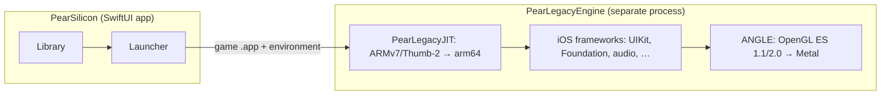

# PearLegacyEngine

**The 32-bit iOS engine of [PearSilicon](https://github.com/denizomer10/PearSilicon) for Apple silicon Macs.**

PearLegacyEngine runs iPhone and iPad apps built for 32-bit ARM (`armv6` and
`armv7`, iOS 2 to iOS 10), which macOS cannot load at all. It is a high-level
emulator: guest ARM code is recompiled to arm64, and the iOS frameworks the app
calls (UIKit, Foundation, Core Animation, OpenGL ES, OpenAL, Audio Toolbox, …)
are reimplemented on the host.

PearLegacyEngine is a fork of [touchHLE](https://github.com/touchHLE/touchHLE)
by hikari_no_yume and the touchHLE contributors. The emulator design and most of
its code are theirs; this fork adapts it to Apple silicon, macOS 26 and
PearSilicon. Upstream's history, authorship and changelog are preserved.

## How it fits into PearSilicon

PearSilicon handles everything the user sees: the library, IPA and `.app`
installation, per-game settings and save data. When a 32-bit game is launched,
it starts this engine as a separate process inside a small per-game `.app` host,
so the game's own name and icon appear in the title bar, menu bar and Dock.



## Features

- **Apple silicon CPU path.** Guest code runs on
  [PearLegacyJIT](https://github.com/denizomer10/PearLegacyJIT), a Dynarmic
  fork tuned for ARMv7/Thumb-2 guests; the engine is built for `apple-m1` with
  ThinLTO.
- **OpenGL ES 1.1 and 2.0 on Metal.** Rendering goes through a bundled ANGLE
  build (`libEGL`, `libGLESv2`) on an `SDL_Metal` view. Guest and presentation
  contexts share one EGL share group; the deprecated macOS OpenGL framework is
  not used.
- **Free window resizing.** The window can be resized or made fullscreen at any
  time. The game's render resolution and touch coordinates stay in its own
  coordinate space; scaling happens only at presentation. HiDPI windows and
  Game Mode frame pacing are supported.
- **Keyboard keymaps.** Reads the `pear-keymap/v1` files PearSilicon edits and
  synthesizes real touches (`tap`, `hold`, `swipe`, dead-zoned `joystick`), so
  touch-only games are playable from the keyboard.
- **Performance HUD.** `PEAR_FPS_HUD=1` draws a frame-rate overlay inside the
  game viewport.
- **Headless by design.** No picker window and no engine branding: the process
  only ever shows the running game.

## Requirements

- Apple silicon Mac with macOS 26 or later (the engine is arm64-only)
- Xcode Command Line Tools with the Metal toolchain
- Rust (stable, `aarch64-apple-darwin`), CMake, GN and Ninja

## Building

```sh
git clone --recursive https://github.com/denizomer10/PearLegacyEngine.git
cd PearLegacyEngine

# ANGLE (Metal) first
(cd vendor/angle && gn gen out/MacMetal --args='is_component_build=true' && ninja -C out/MacMetal libEGL libGLESv2)

# the engine, with PearLegacyJIT as the CPU backend
PEAR_DYNARMIC_ROOT=../PearLegacyJIT MACOSX_DEPLOYMENT_TARGET=26.0 cargo build --release
```

Without `PEAR_DYNARMIC_ROOT` the engine builds the `vendor/dynarmic` submodule.
The bundled SDL2 carries a local macOS fix; apply it once on a fresh checkout:

```sh
git -C "$(dirname "$(find ~/.cargo/git/checkouts/rust-sdl2-* -name SDL -maxdepth 3 | head -1)")" \
  apply "$PWD/patches/SDL-cocoaopengl-multiple-contexts.patch"
```

The binary is `target/release/touchHLE`. It needs these resources next to it:

| Path | Content |
| --- | --- |
| `touchHLE_dylibs/` | guest libraries (`libgcc`, `libstdc++`, zlib, SQLite, libxml2) with their licenses |
| `touchHLE_dylibs/angle/` | the ANGLE Metal runtime from `vendor/angle/out/MacMetal` |
| `touchHLE_fonts/` | Liberation and Noto Sans CJK fonts |
| `touchHLE_default_options.txt` | per-title default options |

`dev-scripts/make-pear-release.sh` assembles that layout, together with the
license files, into `PearLegacyEngine-<version>-macos-arm64.tar.gz`.
PearSilicon's `scripts/setup-legacy-engine.sh` builds and stages it for the app
bundle. More build details are in [dev-docs/building.md](dev-docs/building.md).

## Running directly

PearSilicon starts the engine for you. For testing and diagnostics it can be run
on its own with a `.app` bundle or an `.ipa`:

```sh
./target/release/touchHLE /path/to/Game.app
./target/release/touchHLE --help        # all options
./target/release/touchHLE --copyright   # licenses of everything in the binary
```

| Variable | Purpose |
| --- | --- |
| `PEAR_LEGACY_SANDBOX_ROOT` | where each game's `Documents`, `Library` and `tmp` are kept |
| `PEAR_LEGACY_RESOURCES_DIR` | directory holding `touchHLE_dylibs/`, `touchHLE_fonts/` and the option files |
| `PEAR_ANGLE_LIB_DIR` | ANGLE dylib directory (default `touchHLE_dylibs/angle/`) |
| `PEAR_KEYMAP` | `pear-keymap/v1` JSON file with keyboard bindings |
| `PEAR_FPS_HUD` | `1` draws the frame-rate overlay |
| `PEAR_LEGACY_LOG_FILE` | log file when run outside PearSilicon |
| `PEAR_TOUCH_SCRIPT` | scripted touches (`frame:x:y[:duration],…`) for repeatable tests |
| `PEAR_DUMP_FRAME` | path prefix for raw frame dumps |
| `PEAR_DEBUG_TOUCH`, `PEAR_DEBUG_MODULES` | verbose touch and per-module logging |
| `PEAR_KEYMAP_SELFTEST`, `PEAR_HUD_SELFTEST` | headless self-tests of the keymapper and HUD |

### Keymap format

Coordinates are normalized to `0..1` against the game viewport, origin at the
top left. Bindings with `"source": "controller"` are handled by PearSilicon's
GameController bridge and ignored here.

```json
{
  "version": "pear-keymap/v1",
  "bindings": [
    { "source": "keyboard", "key": "space", "action": "tap", "_0": { "x": 0.516, "y": 0.911 } },
    { "source": "keyboard", "key": "w", "action": "swipe",
      "_0": { "x": 0.5, "y": 0.8 }, "to": { "x": 0.5, "y": 0.3 }, "duration_ms": 150 },
    { "source": "keyboard", "key": "d", "action": "joystick",
      "center": { "x": 0.14, "y": 0.72 }, "radius": 0.10 }
  ]
}
```

## Compatibility

Compatibility is per game and narrower than PearSilicon's 64-bit path: a release
can run one game well and crash in another. [CHANGELOG.md](CHANGELOG.md) lists
what changed and which games were tested. Use the engine only with apps you are
entitled to run; it includes no Apple software and no apps.

## The Pear stack

| Project | Role |
| --- | --- |
| [PearSilicon](https://github.com/denizomer10/PearSilicon) | macOS app: library, installer, launcher |
| [PearRuntime](https://github.com/denizomer10/PearRuntime) | compatibility layer for arm64 iOS apps |
| [PearANGLE](https://github.com/denizomer10/PearANGLE) | OpenGL ES on Metal (ANGLE fork) |
| **PearLegacyEngine** | 32-bit iOS engine (touchHLE fork) |
| [PearLegacyJIT](https://github.com/denizomer10/PearLegacyJIT) | ARMv7 recompiler (Dynarmic fork) |
| [PearDebug](https://github.com/denizomer10/PearDebug) | logging and diagnostics |

## License and credits

- **Source code:** Mozilla Public License 2.0 — see [LICENSE](LICENSE). Files
  keep their original MPL headers.
- **Binaries:** the `touchHLE` executable statically links OpenAL Soft
  (LGPL-2.0-or-later), SDL2, Dynarmic/PearLegacyJIT and other libraries, and is
  distributed under the **GNU General Public License v3.0 or later**
  ([dev-scripts/gpl-3.0.txt](dev-scripts/gpl-3.0.txt), shipped as `COPYING`),
  as upstream touchHLE releases are. `touchHLE --copyright` lists every
  component and its license.
- `touchHLE_dylibs/` and `touchHLE_fonts/` keep their own licenses; see the
  `README.md`, `COPYING.*` and `LICENSE.*` files there.

Credits: [touchHLE](https://github.com/touchHLE/touchHLE) and its contributors,
on whose work this engine is built; [HyperHLE-Reborn](https://github.com/HyperHLE/HyperHLE-Reborn);
[Dynarmic](https://github.com/merryhime/dynarmic) by merryhime; and the authors
of SDL, OpenAL Soft, ANGLE, stb and the other libraries listed by
`touchHLE --copyright`.
